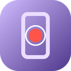

# RecLite

### Graba la pantalla de tu Android: simple, ligera y bonita

[**⬇️ Descargar APK**](https://github.com/Victordelaxx33/RecLite/releases/latest) · [**📲 Instalación**](#-instalación) · [**📸 Capturas**](#-capturas-de-pantalla)

---

## 📱 ¿Qué es RecLite?

**RecLite** (también conocida como **GrabaPantalla**) es una grabadora de pantalla para Android pensada para que la uses desde el primer minuto: pocos botones, perfiles de calidad ya configurados y una interfaz moderna con animaciones.

Sin cuentas, sin anuncios, sin complicaciones. Eliges la calidad, eliges el audio y grabas.

| | |
|---|---|
| 📦 **Paquete** | `com.leo.grabapantalla` |
| 🛠️ **Hecha con** | CodeAssist, directamente desde el teléfono |
| 👤 **Autor** | [Victor](https://github.com/Victordelaxx33) |

---

## 🌟 Características

### 🔐 Permisos claros desde el inicio
La primera vez que abres la app, te explica para qué sirve cada permiso y puedes aceptarlos todos de una vez con **Permitir todo**. Son necesarios para poder grabar.

| Permiso | ¿Para qué sirve? |
|---|---|
| 🎙️ Micrófono | Grabar tu voz |
| 🔔 Notificaciones | Pausar o detener la grabación desde la barra |
| 🪟 Mostrar sobre otras apps | Ver la cuenta atrás encima de cualquier app |

### ⚡ 5 perfiles de calidad
Cada perfil ajusta por ti la resolución, la fluidez (fps) y el bitrate (Mbps). Tú solo eliges el que mejor te sirva y puedes cambiarlo cuando quieras.

| Perfil | Ideal para | Resolución | FPS | Bitrate |
|---|---|---|---|---|
| ⭐ Máxima calidad | Todo el detalle, perfecto para editar | Nativa | 60 | 40 Mbps |
| ⚖️ Equilibrado | Recomendado para casi todo | 1080p | 30 | 12 Mbps |
| 🎮 Juegos | Máxima fluidez en gameplay | Nativa | 60 | 32 Mbps |
| 🍃 Ahorro | Archivos livianos y tutoriales | 720p | 30 | 6 Mbps |

> 📜 En la app encontrarás un quinto perfil más abajo en la lista.

### 🔊 Elige el audio
Decide qué se escucha en tus videos y cámbialo cuando quieras desde la pantalla principal o los Ajustes.

- 🔇 **Sin audio:** video mudo, el más liviano.
- 🎙️ **Solo micrófono:** graba tu voz, ideal para tutoriales o para comentar mientras juegas.
- 🔊 **Sonido del teléfono:** graba lo que suena en el teléfono (juegos, música, videos). Requiere Android 10 o superior.
- 🎧 **Teléfono + micrófono:** el sonido del teléfono y tu voz juntos, ideal para gameplay con comentarios.

> ℹ️ Con el sonido del teléfono, algunas apps (como las llamadas o ciertas apps de video) bloquean la captura y esa parte queda en silencio.

### 🎨 Tu estilo
La app cambia al instante y después puedes ajustarla en Ajustes.

- 🌗 **Modo:** Claro, Oscuro o **AMOLED** (negro puro para ahorrar batería en pantallas OLED).
- 🌈 **Color:** Automático (**Material You**), Lavanda, Océano, Menta, Coral, Ámbar y más.

### 🎬 Y además
- ✨ Interfaz animada y fácil de entender
- 🧭 Mini tutorial de bienvenida
- ⏱️ Cuenta atrás antes de empezar a grabar
- 🔔 Control desde la barra de notificaciones

---

## 📲 Instalación

Descarga RecLite directamente desde GitHub:

1. Ve a [**Releases**](https://github.com/Victordelaxx33/RecLite/releases/latest).
2. Descarga el archivo `.apk` de la última versión.
3. Ábrelo y, si Android lo pide, permite instalar apps de esta fuente.
4. Abre RecLite y acepta los permisos para empezar a grabar.

> 🔄 Para actualizar, descarga el APK de la versión nueva e instálalo encima: no pierdes tus ajustes.

---

## 📸 Capturas de pantalla

| 🔐 Permisos | ⚡ Perfiles |
|:---:|:---:|
|  |  |

| 🔊 Audio | 🎨 Estilo |
|:---:|:---:|
|  |  |

---

## 🔨 Compilación

El proyecto está hecho para abrirse y compilarse en **CodeAssist** en un dispositivo Android.

1. Abre el proyecto en CodeAssist.
2. Compila el proyecto (**Build / Assemble**) para generar el APK.
3. Firma el APK y súbelo como archivo adjunto en un nuevo [Release](https://github.com/Victordelaxx33/RecLite/releases/new).

---

## 🚧 Estado del proyecto

🟢 **En desarrollo activo.** Se sigue mejorando la interfaz, el tutorial, los permisos y los temas.

---

Hecho con 💜 por **Victor**

