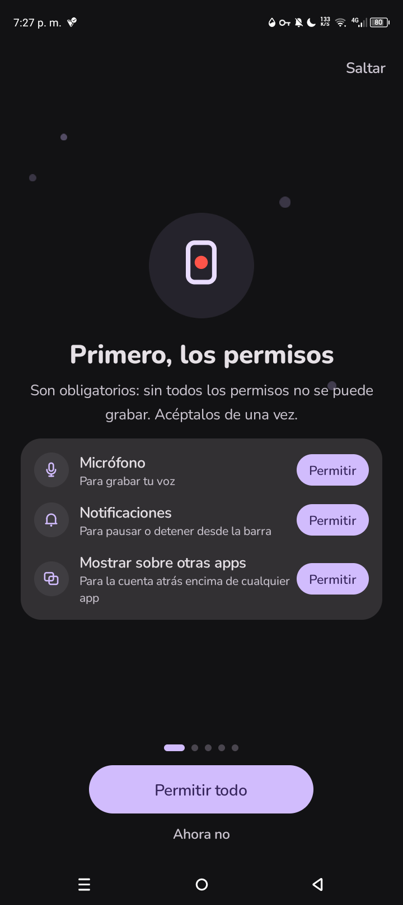
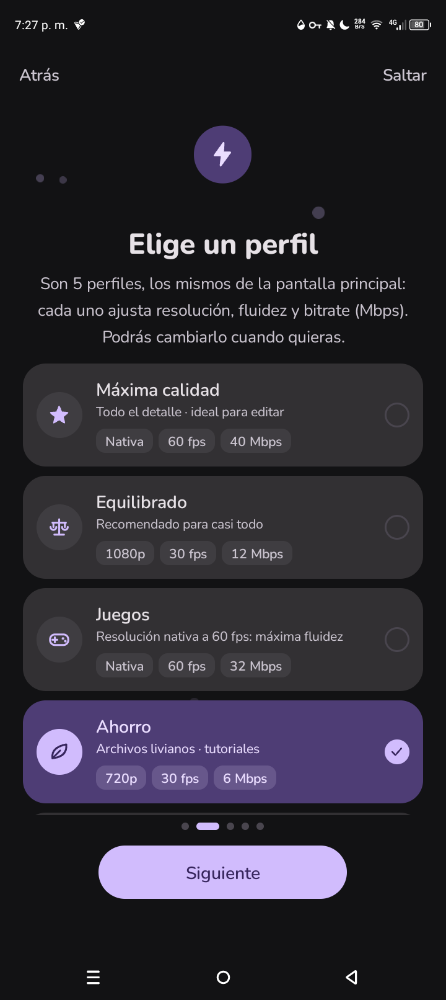
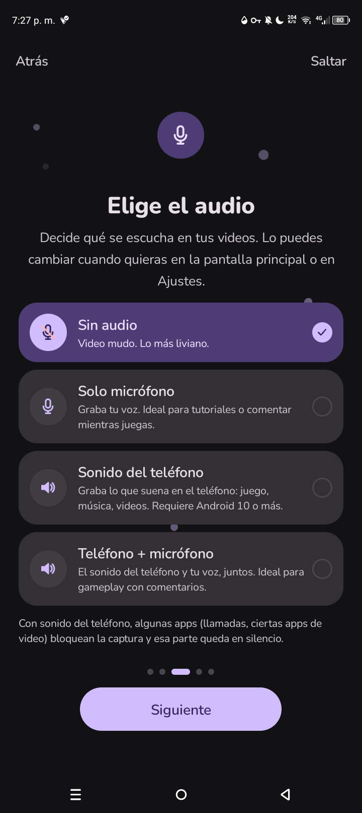
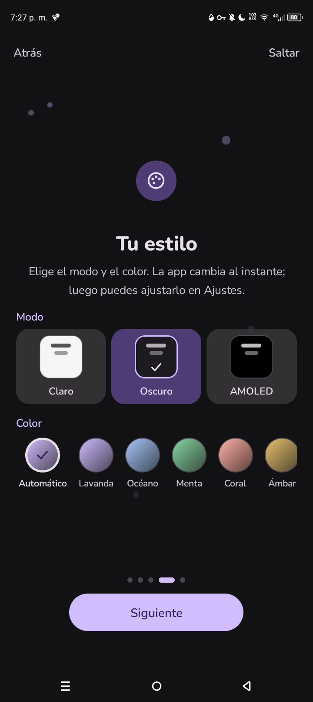

# 🔴 RecLite

### Grabadora de pantalla para Android, simple, ligera y bonita ✨

---

## 📱 ¿Qué es RecLite?

**RecLite** (también conocida como **GrabaPantalla**) es una app de Android para **grabar la pantalla de tu teléfono** de forma fácil y rápida. Está pensada para que cualquier persona la entienda desde el primer minuto: pocos botones, perfiles de calidad listos para usar y una interfaz moderna con animaciones.

- 📦 **Paquete:** `com.leo.grabapantalla`
- 🛠️ **Desarrollada en:** AIDE, directamente desde el teléfono
- 👤 **Autor:** Victor

---

## 🌟 Características

### 🔐 Permisos claros desde el inicio
Al abrir la app por primera vez, te explica para qué sirve cada permiso y puedes aceptarlos todos de una vez con **Permitir todo**:

| Permiso | ¿Para qué sirve? |
|---|---|
| 🎙️ Micrófono | Para grabar tu voz |
| 🔔 Notificaciones | Para pausar o detener desde la barra |
| 🪟 Mostrar sobre otras apps | Para la cuenta atrás encima de cualquier app |

### ⚡ 5 perfiles de calidad
Cada perfil ajusta la resolución, la fluidez y el bitrate (Mbps) por ti. Solo eliges el que mejor te sirva:

| Perfil | Descripción | Resolución | FPS | Bitrate |
|---|---|---|---|---|
| ⭐ Máxima calidad | Todo el detalle, ideal para editar | Nativa | 60 | 40 Mbps |
| ⚖️ Equilibrado | Recomendado para casi todo | 1080p | 30 | 12 Mbps |
| 🎮 Juegos | Máxima fluidez | Nativa | 60 | 32 Mbps |
| 🍃 Ahorro | Archivos livianos, para tutoriales | 720p | 30 | 6 Mbps |

> 📜 La lista tiene un quinto perfil más abajo dentro de la app.

### 🔊 Elige el audio
Decide qué se escucha en tus videos, y cámbialo cuando quieras desde la pantalla principal o los Ajustes:

- 🔇 **Sin audio:** video mudo, lo más liviano.
- 🎙️ **Solo micrófono:** graba tu voz, ideal para tutoriales o comentar mientras juegas.
- 🔊 **Sonido del teléfono:** graba lo que suena en el teléfono (juegos, música, videos). Requiere Android 10 o más.
- 🎧 **Teléfono + micrófono:** el sonido del teléfono y tu voz juntos, ideal para gameplay con comentarios.

> ℹ️ Con el sonido del teléfono, algunas apps (como llamadas o ciertas apps de video) bloquean la captura y esa parte queda en silencio.

### 🎨 Tu estilo
La app cambia al instante y luego puedes ajustarlo en Ajustes.

- 🌗 **Modo:** Claro, Oscuro o **AMOLED** (negro puro para ahorrar batería).
- 🌈 **Color:** Automático (**Material You**), Lavanda, Océano, Menta, Coral, Ámbar y más.

### 🎬 Y además
- ✨ Interfaz animada y fácil de entender
- 🧭 Mini tutorial de bienvenida
- ⏱️ Cuenta atrás antes de grabar
- 🔔 Control desde la barra de notificaciones

---

## 📸 Capturas de pantalla

| 🔐 Permisos | ⚡ Perfiles |
|:---:|:---:|
|  |  |

| 🔊 Audio | 🎨 Estilo |
|:---:|:---:|
|  |  |

---

## 🚧 Estado del proyecto

🟢 **En desarrollo activo.** Se sigue mejorando la interfaz, el tutorial, los permisos y los temas.

## 🔨 Compilación

El proyecto está hecho para abrirse y compilarse en **AIDE** en un dispositivo Android.

---

Hecho con 💜 por **Victor**

